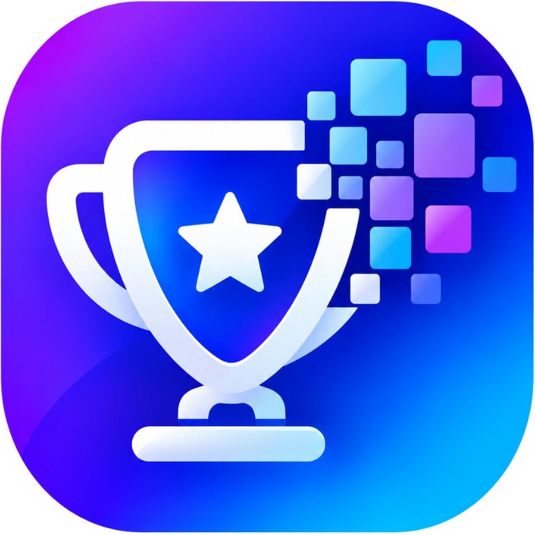
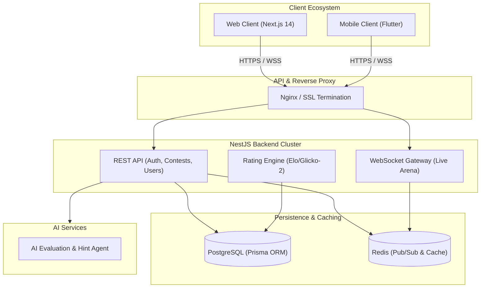

<div align="center">

  <br />
  
  <br />

  <h1>Olympido</h1>
  <p><strong>Next-Generation Academic Olympiad & Competitive Contest Platform</strong></p>

  <p>
    <a href="https://github.com/nivrosys/olympido/blob/main/LICENSE"></a>
    
    
    
    
    
    
  </p>

  <p>
    <em>Engineered by <a href="https://www.nivrosys.com"><strong>Nivrosys</strong></a> — Building Next-Gen Esports Platforms, AI Integrations & High-Scale Systems.</em>
  </p>

</div>

---

## 📌 Executive Overview

**Olympido** is an enterprise-grade competitive academic contest platform engineered to deliver the speed, reliability, and excitement of modern esports tournament platforms to academic Olympiads (Mathematics, Physics, Chemistry, Informatics, and more).

It empowers verified educational institutions and teachers to host secure, high-concurrency competitions while providing students with an interactive arena featuring real-time rating adjustments, live podium leaderboards, and cryptographically verifiable digital scorecards.

---

## 🌟 Key Capabilities & Features

* ⚡ **Real-Time Elo & Glicko-2 Rating Engine**: Automated sub-second rating recalculations after contest conclusions, supporting dynamic tiering (Novice, Contender, Grandmaster) and percentile ranks.
* 🏛️ **Institutional Verification Pipeline**: Domain-based validation (`.edu`, `.ac`) and manual verification workflows for schools, universities, and contest organizers.
* 📡 **Live Contest Arena & WebSockets**: Low-latency WebSocket telemetry for synchronized countdown timers, instant answer submissions, and live scoreboards.
* 🤖 **AI-Assisted Evaluation & Hint Engine**: Integrated autonomous AI agents providing automated step-by-step grading, contest hints, and contextual feedback.
* 🛡️ **Role-Based Access Control (RBAC)**: Fine-grained permissions separating **Students**, **Teachers**, **Organizers**, and **Platform Administrators**.
* 📱 **Cross-Platform Ecosystem**: Unified experience across web (Next.js) and mobile clients (iOS / Android).

---

## 🏗️ System Architecture



---

## 📁 Repository Structure

```text
olympido/
├── backend/          # NestJS REST API, WebSocket gateway, Prisma ORM, Rating Engine
├── frontend/         # Next.js 14 reactive web interface & design system
├── mobile/           # Cross-platform mobile application
├── ai-agent/         # AI automated grading, hints, and contest evaluation service
├── docs/             # Comprehensive technical design specifications
│   ├── SYSTEM_DESIGN.md   # System architecture, RBAC, DB schemas & APIs
│   ├── BACKEND_PLAN.md    # Multi-phase execution plan & deployment guides
│   └── UI_UX_DESIGN.md    # Design tokens, user journeys & component hierarchy
├── docker-compose.yml # Containerized multi-service orchestration
└── tools/            # Developer automation and auxiliary tooling
```

---

## 🚀 Quickstart & Local Deployment

### Prerequisites
* [Docker & Docker Compose](https://www.docker.com/) (Recommended)
* [Node.js](https://nodejs.org/) v18+ and `npm`

### 1. Launch with Docker Compose (Single Command)
```bash
docker compose up -d
```
This boots up:
* **PostgreSQL Database** on port `5432`
* **Redis In-Memory Cache** on port `6379`
* **Backend API** on port `3000`
* **Frontend Application** on port `3001`

### 2. Manual Development Setup
```bash
# Backend Setup
cd backend
npm install
npm run start:dev

# Frontend Setup
cd ../frontend
npm install
npm run dev
```

---

## 📖 In-Depth Technical Documentation

Comprehensive specifications and architectural blueprints are available under [`docs/`](./docs):

* 📘 [**System Design & Architecture Specification**](docs/SYSTEM_DESIGN.md): Detailed database schema, REST API endpoints, rating formulas, and institutional verification logic.
* 📗 [**Backend Execution & Deployment Guide**](docs/BACKEND_PLAN.md): Complete phase-by-phase implementation details and production deployment guides.
* 📙 [**UI/UX Design Tokens & Component Guide**](docs/UI_UX_DESIGN.md): Visual identity, typography, dark mode guidelines, and user flows.

---

## 💼 Commercial Licensing & Custom Software Inquiries

Need a custom competitive tournament platform, high-scale esports bracket engine, or enterprise AI automation system?

* 🌐 **Website**: [www.nivrosys.com](https://www.nivrosys.com)
* 📬 **Direct Inquiries**: [contact@nivrosys.com](mailto:contact@nivrosys.com)
* 🏢 **Organization**: Nivrosys — *Engineering High-Performance Digital Products*

---

## 📄 License

This project is licensed under the [MIT License](LICENSE).
