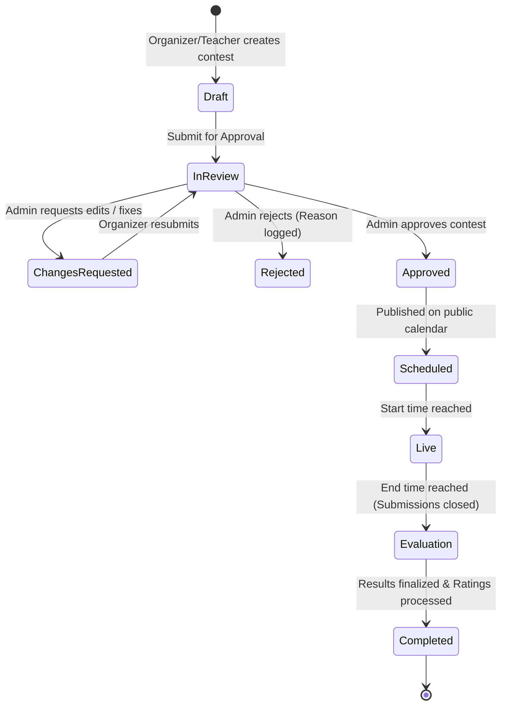
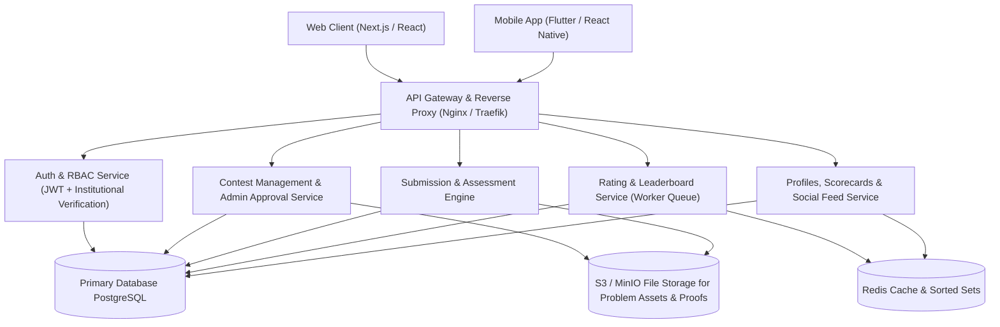

# Olympido — System Design & Architecture Specification

**Document Version:** 1.0.0  
**Status:** Approved for Implementation  
**Target Systems:** Web (`frontend/`), Backend API (`backend/`), Mobile (`mobile/`), AI Services (`ai-agent/`)

---

## 1. Executive Summary & Product Vision

**Olympido** is a next-generation competitive academic Olympiad and contest platform (covering Physics, Mathematics, Chemistry, Informatics, and General Science). It empowers educational organizations and teachers to host verified contests while giving students a gamified arena to compete, earn ratings, track skill growth, and showcase verified digital scorecards.

### Key Value Pillars
1. **Curated & Verified Contests**: No spam or low-quality contests. All contests submitted by organizers or teachers must pass through a strict **Admin Review & Approval Pipeline** before publishing.
2. **Institutional Authenticity**: Organizers and schools cannot sign up with generic webmail (e.g., `@gmail.com`). They must use institutional emails (`.edu`, `.ac.*`, or accredited school domains) backed by organization validation.
3. **Dynamic Rating & Points Engine**: Performance in every Olympiad feeds into a multi-tiered rating and points system. Top ranks receive weighted points, powering **Weekly, Monthly, and All-Time Leaderboards**.
4. **Student Scorecards & Social Showcase**: Students can generate verified digital scorecards displaying their contest performance and daily rating milestones to share across the platform and external networks.

---

## 2. User Roles & Permission Matrix (RBAC)

The system enforces four distinct roles with strictly isolated privileges:

| Capability / Action | Student | Teacher | Organizer (School/Org) | Platform Admin |
| :--- | :---: | :---: | :---: | :---: |
| Self-Registration via Public Webmail / OAuth |  |  (Requires approval) |  (Requires .edu / domain) |  (Internal only) |
| Browse & Register for Approved Contests |  |  |  |  |
| Participate in Live Contests & Submit Work |  |  |  |  |
| View Personal Rating, Profile & Scorecards |  |  |  |  |
| Publish Student Scorecard / Activity Posts |  |  |  |  |
| Create Contest / Practice Exam |  |  (Requires Admin Approval) |  (Requires Admin Approval) |  (Direct publish) |
| Grade / Evaluate Contest Submissions |  |  (Assigned contests) |  (Own contests) |  (Super-evaluator) |
| Submit Contest to Admin Review Queue |  |  |  | N/A |
| Approve / Reject / Request Contest Changes |  |  |  |  |
| Domain Whitelist & Institution Verification |  |  |  |  |
| Platform Moderation & Leaderboard Recalibration |  |  |  |  |

---

## 3. Authentication & Institutional Verification Engine

```
+---------------------------------------------------------------------------------+
|                       REGISTRATION & ONBOARDING WORKFLOW                        |
+---------------------------------------------------------------------------------+

       [ Student ]                                    [ Organizer / School ]
            |                                                    |
   Standard Signup Form                                Institutional Signup Form
  (Email / Google / OAuth)                           (Requires Institutional Email)
            |                                                    |
            v                                                    v
   Instant Activation                                  Domain & MX Verification Check
            |                                                    |
     [ Student Role ]                         +------------------+------------------+
                                              |                                     |
                                        Invalid Domain                       Valid Institutional
                                      (@gmail, @yahoo...)                     Domain (.edu, .ac)
                                              |                                     |
                                         REJECTED                                   v
                                  "Institutional email req."            Pending Org Verification
                                                                                    |
                                                                                    v
                                                                           Admin Audit & Approval
                                                                                    |
                                                                                    v
                                                                          [ Organizer Role ]
```

### 3.1 Student Registration
- Open registration via standard email/password or OAuth 2.0 (Google, GitHub, Apple).
- Instant account activation with standard email verification link.

### 3.2 Organizer & School Verification Algorithm
Organizers represent institutions (schools, universities, Olympiad committees, academic academies). To protect platform credibility:
1. **Restricted Domain Validation**:
   - The signup system executes regex and domain lookup rules.
   - **Disallowed Provider Blacklist**: Blocks public free email providers (`gmail.com`, `yahoo.com`, `outlook.com`, `hotmail.com`, `proton.me`, etc.).
   - **Allowed Institutional Patterns**: Matches `.edu`, `.edu.*`, `.ac.*`, `.k12.*`, or domains verified in the `OrganizationDomainWhitelist` table.
2. **DNS & MX Record Check**: Confirms active mail server records for the domain.
3. **Institutional KYC & Admin Activation**:
   - Upon registration, an `Organization` record is generated in `PENDING_VERIFICATION` status.
   - Admin inspects the organization's accreditation proof, official website, and designated contact person before enabling contest creation privileges.

---

## 4. Contest Lifecycle & Admin Approval Pipeline

Every contest hosted by an Organizer or Teacher must progress through an auditable state machine:



### 4.1 Contest Lifecycle States
1. `DRAFT`: Organizer or teacher builds contest details (title, subject category, description, problem sets/questions, rules, prizes, duration, and scoring tiers).
2. `IN_REVIEW`: Organizer hits **Submit for Approval**. The contest is locked against editing and enqueued in the Admin Review Queue.
3. `CHANGES_REQUESTED`: Admin flags specific issues (e.g., unclear question prompt, scheduling clash, copyright infringement) with mandatory reviewer feedback.
4. `APPROVED`: Admin confirms contest quality. The contest is published to the public Olympiad registry in `SCHEDULED` status.
5. `LIVE`: The contest opens for participant submissions at the scheduled start timestamp.
6. `EVALUATION`: Submissions are evaluated (auto-graded MCQs/testcases and manual rubrics for theoretical solutions).
7. `COMPLETED`: Final ranks are frozen, points and ratings are distributed, and certificates/scorecards become available.

---

## 5. Scoring, Rating & Gamification Engine

```
+---------------------------------------------------------------------------------+
|                         CONTEST SCORING & RATING FLOW                           |
+---------------------------------------------------------------------------------+

   Live Contest Submissions
             |
             v
   Raw Score Computation (Accuracy + Speed/Time Penalty)
             |
             v
   Final Rank Ordering (Rank 1 to N)
             |
             +------------------------------------+
             |                                    |
             v                                    v
     Point Award Engine                  Elo/Glicko Rating Engine
   Points = f(Rank, Participants,      New Rating = Old + K*(S_actual - S_expected)
             Difficulty)                          |
             |                                    v
             v                           Daily/Weekly/Monthly Delta
     Profile Total Points                         |
             |                                    v
             +-----------------+------------------+
                               |
                               v
                     Leaderboard Updates
                   (Weekly, Monthly, All-Time)
                               |
                               v
                     Shareable Scorecard
```

### 5.1 Points Calculation Formula
Each contest awards **Olympiad Points** based on rank achieved, total participant pool, and contest difficulty tier:

$$\text{Points} = \text{BasePoints}(\text{Difficulty}) \times \left(1 - \frac{\text{Rank} - 1}{\text{Participants}}\right)^{\alpha} + \text{Bonus}(\text{TopRank})$$

- **Difficulty Multiplier**:
  - School Level / Beginner: 100 base points
  - Regional Olympiad: 250 base points
  - National Olympiad: 500 base points
  - International / Grandmaster: 1,000 base points
- **Top Rank Bonus**:
  - Rank 1: +50% bonus points
  - Rank 2: +30% bonus points
  - Rank 3: +20% bonus points
  - Top 10: +10% bonus points

### 5.2 Performance Rating Algorithm (Glicko-2 / Elo Variant)
In addition to cumulative points, students possess a dynamic **Skill Rating** (similar to Codeforces / Chess):
- **Initial Default Rating**: 1,200.
- **Rating Tiers**:
  - **Novice**: 0 – 1,199
  - **Pupil**: 1,200 – 1,399
  - **Specialist**: 1,400 – 1,599
  - **Expert**: 1,600 – 1,899
  - **Candidate Master**: 1,900 – 2,199
  - **Master**: 2,200 – 2,399
  - **Grandmaster**: 2,400+
- Following each contest, expected performance is calculated against all other competitors in the division, yielding an updated rating and rating change ($\Delta$).

### 5.3 Leaderboard Architecture
Olympido features three high-speed leaderboard views backed by **Redis Sorted Sets (`ZSET`)**:
1. **Weekly Leaderboard**: Resets every Sunday at midnight UTC. Measures points accumulated over the 7-day rolling window.
2. **Monthly Championship**: Tracks points won in the current calendar month.
3. **All-Time Hall of Fame**: Ranked by all-time cumulative points and peak rating.
4. **Subject Filter**: Sub-leaderboards for Physics, Mathematics, Chemistry, Informatics, and Astronomy.

---

## 6. Student Scorecard & Social Feed

1. **Digital Scorecard**:
   - Each completed contest produces an official, cryptographic **Scorecard** displaying:
     - Student Name, Avatar, and School/Institution.
     - Contest Title, Date, and Category.
     - Final Rank, Percentile, Raw Score, Rating Change ($\pm \Delta$), and Points Gained.
     - Unique Verification Hash & QR Code linking to `olympido.com/verify/<scorecard_id>`.
2. **Community & Activity Feed**:
   - Students can publish their scorecards, daily practice streaks, and rating milestones to the platform feed.
   - Fellow students and teachers can react, leave supportive comments, and discuss contest problem sets.

---

## 7. System Architecture & Tech Stack



### Recommended Technology Stack
- **Frontend**: Next.js 14+ (App Router), TypeScript, Vanilla CSS / Tailwind (as requested), Lucide Icons, Framer Motion.
- **Backend**: Node.js (NestJS / Express) or Go (Fiber/Gin), REST & WebSocket APIs for live contests.
- **Database**: PostgreSQL 16 (Relational integrity, ACID compliance, JSONB for dynamic question formats).
- **Caching & Real-Time Leaderboards**: Redis (Sorted Sets for $O(\log(N))$ rank queries).
- **Task & Event Queue**: BullMQ / Celery (Async rating recalculation, batch score evaluation).
- **Storage**: AWS S3 or MinIO (Contest PDF problems, institutional verification certificates, student avatars).

---

## 8. Relational Database Schema (PostgreSQL)

```sql
-- 1. Users & Profiles
CREATE TYPE user_role AS ENUM ('STUDENT', 'TEACHER', 'ORGANIZER', 'ADMIN');
CREATE TYPE org_status AS ENUM ('PENDING_VERIFICATION', 'VERIFIED', 'REJECTED', 'SUSPENDED');

CREATE TABLE users (
    id UUID PRIMARY KEY DEFAULT gen_random_uuid(),
    email VARCHAR(255) UNIQUE NOT NULL,
    password_hash VARCHAR(255) NOT NULL,
    role user_role NOT NULL DEFAULT 'STUDENT',
    full_name VARCHAR(150) NOT NULL,
    username VARCHAR(50) UNIQUE NOT NULL,
    avatar_url TEXT,
    bio TEXT,
    institution_name VARCHAR(255),
    is_email_verified BOOLEAN DEFAULT FALSE,
    created_at TIMESTAMP WITH TIME ZONE DEFAULT NOW(),
    updated_at TIMESTAMP WITH TIME ZONE DEFAULT NOW()
);

-- 2. Organizations & Domain Whitelists
CREATE TABLE organizations (
    id UUID PRIMARY KEY DEFAULT gen_random_uuid(),
    name VARCHAR(255) NOT NULL,
    official_domain VARCHAR(255) UNIQUE NOT NULL, -- e.g., 'mit.edu', 'ox.ac.uk'
    contact_email VARCHAR(255) NOT NULL,
    accreditation_document_url TEXT,
    status org_status DEFAULT 'PENDING_VERIFICATION',
    verified_by UUID REFERENCES users(id),
    created_at TIMESTAMP WITH TIME ZONE DEFAULT NOW()
);

-- 3. Contests & Approval Workflow
CREATE TYPE contest_status AS ENUM (
    'DRAFT', 
    'IN_REVIEW', 
    'CHANGES_REQUESTED', 
    'APPROVED', 
    'LIVE', 
    'EVALUATION', 
    'COMPLETED', 
    'REJECTED'
);

CREATE TYPE contest_category AS ENUM (
    'PHYSICS', 
    'MATHEMATICS', 
    'CHEMISTRY', 
    'INFORMATICS', 
    'BIOLOGY', 
    'ASTRONOMY'
);

CREATE TABLE contests (
    id UUID PRIMARY KEY DEFAULT gen_random_uuid(),
    creator_id UUID NOT NULL REFERENCES users(id),
    organization_id UUID REFERENCES organizations(id),
    title VARCHAR(255) NOT NULL,
    slug VARCHAR(255) UNIQUE NOT NULL,
    category contest_category NOT NULL,
    description TEXT NOT NULL,
    rules TEXT NOT NULL,
    difficulty_level VARCHAR(50) DEFAULT 'REGIONAL',
    banner_url TEXT,
    status contest_status DEFAULT 'DRAFT',
    
    -- Schedule
    registration_start_at TIMESTAMP WITH TIME ZONE NOT NULL,
    registration_end_at TIMESTAMP WITH TIME ZONE NOT NULL,
    contest_start_at TIMESTAMP WITH TIME ZONE NOT NULL,
    contest_end_at TIMESTAMP WITH TIME ZONE NOT NULL,
    duration_minutes INT NOT NULL,
    
    -- Scoring parameters
    max_score INT NOT NULL DEFAULT 100,
    base_points INT NOT NULL DEFAULT 500,
    
    -- Admin Approval Tracking
    reviewed_by UUID REFERENCES users(id),
    admin_review_notes TEXT,
    reviewed_at TIMESTAMP WITH TIME ZONE,
    
    created_at TIMESTAMP WITH TIME ZONE DEFAULT NOW(),
    updated_at TIMESTAMP WITH TIME ZONE DEFAULT NOW()
);

-- 4. Contest Registrations & Submissions
CREATE TABLE contest_registrations (
    id UUID PRIMARY KEY DEFAULT gen_random_uuid(),
    contest_id UUID NOT NULL REFERENCES contests(id) ON DELETE CASCADE,
    user_id UUID NOT NULL REFERENCES users(id) ON DELETE CASCADE,
    registered_at TIMESTAMP WITH TIME ZONE DEFAULT NOW(),
    UNIQUE(contest_id, user_id)
);

CREATE TABLE submissions (
    id UUID PRIMARY KEY DEFAULT gen_random_uuid(),
    contest_id UUID NOT NULL REFERENCES contests(id),
    user_id UUID NOT NULL REFERENCES users(id),
    raw_score NUMERIC(6, 2) DEFAULT 0.00,
    time_taken_seconds INT NOT NULL,
    submitted_at TIMESTAMP WITH TIME ZONE DEFAULT NOW(),
    evaluation_status VARCHAR(50) DEFAULT 'PENDING'
);

-- 5. Contest Results & Points Awarded
CREATE TABLE contest_results (
    id UUID PRIMARY KEY DEFAULT gen_random_uuid(),
    contest_id UUID NOT NULL REFERENCES contests(id),
    user_id UUID NOT NULL REFERENCES users(id),
    final_rank INT NOT NULL,
    percentile NUMERIC(5, 2) NOT NULL,
    points_awarded INT NOT NULL,
    pre_rating INT NOT NULL,
    post_rating INT NOT NULL,
    rating_delta INT NOT NULL,
    is_disqualified BOOLEAN DEFAULT FALSE,
    scorecard_qr_hash VARCHAR(64) UNIQUE NOT NULL,
    created_at TIMESTAMP WITH TIME ZONE DEFAULT NOW(),
    UNIQUE(contest_id, user_id)
);

-- 6. Student Ratings & Points Ledger
CREATE TABLE student_stats (
    user_id UUID PRIMARY KEY REFERENCES users(id) ON DELETE CASCADE,
    current_rating INT DEFAULT 1200,
    peak_rating INT DEFAULT 1200,
    total_points BIGINT DEFAULT 0,
    weekly_points INT DEFAULT 0,
    monthly_points INT DEFAULT 0,
    contests_participated INT DEFAULT 0,
    podium_finishes INT DEFAULT 0, -- Ranks 1, 2, 3
    updated_at TIMESTAMP WITH TIME ZONE DEFAULT NOW()
);

-- 7. Student Scorecard Posts & Social Activity
CREATE TABLE posts (
    id UUID PRIMARY KEY DEFAULT gen_random_uuid(),
    user_id UUID NOT NULL REFERENCES users(id) ON DELETE CASCADE,
    contest_result_id UUID REFERENCES contest_results(id),
    caption TEXT,
    scorecard_image_url TEXT,
    likes_count INT DEFAULT 0,
    created_at TIMESTAMP WITH TIME ZONE DEFAULT NOW()
);
```

---

## 9. Core REST API Endpoints Specification

### 9.1 Authentication & Onboarding
- `POST /api/v1/auth/register/student`: Public registration for student accounts.
- `POST /api/v1/auth/register/organizer`: Institutional registration requiring validated educational domain and organization details.
- `POST /api/v1/auth/login`: Issues access and refresh tokens with role claims.
- `GET /api/v1/auth/me`: Fetches authenticated user profile, permissions, and institution status.

### 9.2 Contests (Public & Organizers)
- `GET /api/v1/contests`: Public catalog of approved upcoming, live, and past contests (supports category and difficulty filters).
- `GET /api/v1/contests/:slug`: Detailed view with rules, timeline, prizes, and registration status.
- `POST /api/v1/contests`: (Organizer / Teacher) Create a contest in `DRAFT` status.
- `PUT /api/v1/contests/:id`: Update draft contest details and problem sets.
- `POST /api/v1/contests/:id/submit-review`: Transition contest status from `DRAFT` to `IN_REVIEW`.
- `POST /api/v1/contests/:id/register`: Student registers for an upcoming contest.

### 9.3 Admin Moderation Queue
- `GET /api/v1/admin/contests/pending`: List all contests awaiting administrative inspection.
- `POST /api/v1/admin/contests/:id/approve`: Approve contest for public listing.
- `POST /api/v1/admin/contests/:id/reject`: Reject contest with feedback/reason.
- `POST /api/v1/admin/contests/:id/request-changes`: Return contest to organizer with required modifications.
- `GET /api/v1/admin/organizations/pending`: Review institutions applying for organizer privileges.
- `POST /api/v1/admin/organizations/:id/verify`: Approve institution official domain and status.

### 9.4 Submissions, Results & Scorecards
- `POST /api/v1/contests/:id/submit`: Participant uploads contest solutions.
- `GET /api/v1/contests/:id/results`: Official finalized rankings table.
- `GET /api/v1/users/:username/scorecards`: Get historical digital scorecards for a student.
- `GET /api/v1/verify/scorecard/:hash`: Public authenticity verification for a digital scorecard.

### 9.5 Leaderboards & Social
- `GET /api/v1/leaderboards/weekly`: Top students ranked by points in the current week.
- `GET /api/v1/leaderboards/monthly`: Top students in the current month.
- `GET /api/v1/leaderboards/all-time`: Global leaderboard by rating and all-time points.
- `POST /api/v1/posts`: Student posts scorecard to platform activity feed.
- `GET /api/v1/feed`: Community activity feed with recent scorecards and achievements.

---

## 10. Security, Anti-Cheat & Scalability

1. **Anti-Cheat & Plagiarism Controls**:
   - Submission hashing and similarity detection across theoretical and code submissions.
   - Tab-switching detection and fullscreen enforcement during active contest windows.
   - IP and session tracking to prevent concurrent submissions from multiple devices.
2. **High-Concurrency Handling for Contest Rush**:
   - Cached contest metadata in Redis to absorb heavy traffic at contest start.
   - Decoupled submission ingestion: Submissions are written immediately to a resilient queue (BullMQ/Kafka) and acknowledged to the client, preventing database write exhaustion.
3. **Audit Trail**:
   - Immutable audit logging on all administrative actions (approvals, rejections, manual score overrides).
